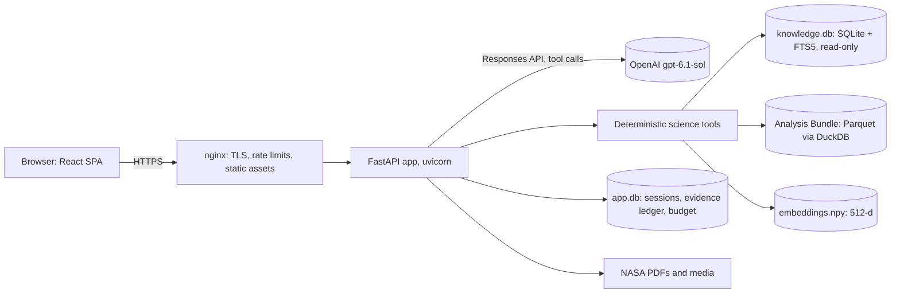

# EmberNova

**Evidence-grounded SI research workspace for spacecraft and habitat fire safety, built on NASA microgravity combustion data.**

NASA Space Apps Challenge 2026 · Challenge: [Flame in Freefall: SI-Powered Fire Safety Insights from Microgravity Combustion Data](https://www.spaceappschallenge.org/2026/challenges/flame-in-freefall/) · Team **EmberNova**

**Live demo: https://embernova.khedmetak.com** · Judges: start with the [Judging Guide](docs/JUDGING_GUIDE.md).

---

## The problem

Fire behaves differently without gravity. There is no buoyant convection, so flames are slower, cooler and longer-lived, and some materials burn in microgravity under conditions where they would self-extinguish on Earth. NASA has flown decades of combustion experiments on the ISS and other platforms (FLEX, CFI, BASS, Saffire, SAME, ACME and others) and published the data through the [Physical Sciences Informatics (PSI)](https://psi.nasa.gov/) system and the NASA Technical Reports Server.

That evidence is hard to use. It is spread over hundreds of spreadsheets, PDFs and videos with inconsistent units and column conventions. Burning rate is K in mm²/s. "O/N/CO" means O₂/N₂/CO₂ mole fractions. Pressure appears in mmHg, atm or psi. An engineer asking *"What do NASA experiments say about fire in a 34% O₂, ~10 psi lunar-habitat atmosphere?"* must find the right investigations, read the right tables correctly, and avoid the classic mistakes: treating microgravity as lunar gravity, confusing design matrices with measurements, or mixing up O₂ fraction and O₂ partial pressure.

## The solution

EmberNova lets a researcher ask that question in plain language. A single OpenAI agent plans the research, but **every number comes from deterministic backend tools** that query a curated, unit-normalized copy of the NASA data. Each claim is cited back to a NASA page, table row or video:

1. **Find:** hybrid retrieval ranks the 34 relevant NASA investigations and explains each match (study type, matching and differing conditions, unrecorded parameters).
2. **Measure:** typed tools query 1,161 curated test runs from 13 NASA tables, with raw and SI values side by side, and build charts only from source rows.
3. **Check:** comparisons name their confounders, the *Applicability Envelope* shows which NASA tests bracket a target atmosphere, and evidence is classified as direct, indirect or insufficient.
4. **Cite:** citation markers resolve to an evidence ledger holding the NASA file SHA-256, page or row locator and transformation. Invalid citations are removed visibly, and unsupported numbers are flagged.

It deliberately does **not** produce fire-risk scores or lunar or Martian predictions. PSI contains no partial-gravity run data, and the app says so.

## Main features

All of the following are implemented and running on the live site:

| Feature | Where |
| --- | --- |
| SI research chat with streaming tool activity, inline ranking cards, charts, comparisons and page-level citations | `/workspace` |
| Recorded demonstrations that replay without any API call (three deterministic, two recorded live) | `/featured` |
| Investigation explorer (34 investigations) with NASA PSI and DOI links | `/investigations` |
| Dataset explorer: raw ⇄ normalized toggle, source rows, CSV export with file hashes | `/data/PSI-69:flex_experimental` |
| Run comparison with named confounders | `/compare` |
| Habitat Applicability Envelope (atmosphere coverage ≠ gravity coverage) | `/envelope` |
| Fire-safety systems view and evidence-coverage map | `/systems`, `/evidence-map` |
| Original NASA video and images with byte-range streaming | `/media` |
| Evidence inspector: source excerpt, full PDF page text, SHA-256, link to the original source | Any citation |
| Analysis Lab: SI-written Python run only in an OpenAI-hosted, network-disabled container, never on the server | Composer toggle |
| d²-law consistency check, suppression overview, model-ready data export | Tools and API |

## Architecture



The model plans and explains. Tools search, query, convert units (pint), compare and chart. The evidence ledger links every displayed number to its source. Details: [docs/ARCHITECTURE.md](docs/ARCHITECTURE.md).

## Technology stack

- **Backend:** Python 3.12, FastAPI, uvicorn, Pydantic v2, pandas, DuckDB, PyArrow/Parquet, SQLite (FTS5), pint, NumPy, tiktoken. The offline corpus build uses PyMuPDF, openpyxl and Pillow.
- **SI:** OpenAI Responses API with strict function tools and streaming. Agent model `gpt-6.1-sol` (fallback `gpt-6.1-terra`), embeddings `text-embedding-3-small` at 512 dimensions, OpenAI hosted Code Interpreter for the optional Analysis Lab.
- **Frontend:** Vite, React 18, TypeScript, Tailwind CSS, TanStack Query, Zustand, React Router, Plotly (cartesian bundle), three.js (intro scene), react-markdown.
- **Tooling:** uv, pytest, ruff, Vitest, ESLint, Playwright.
- **Hosting:** Ubuntu 24.04 VPS, systemd, nginx, Let's Encrypt ([ADR-016](docs/decisions/ADR-016-systemd-deployment.md)).

## Data sources

NASA PSI combustion investigations (FLEX, FLEX-2, CFI, CFI-G, BASS, BASS-II, Saffire I–III, SAME, SAME-R, ACME and others), 93 NASA documents (3,187 pages, including NASA/TP-2015-216046), and 39 original NASA media items. All were retrieved on 2026-11-13 and verified by SHA-256. PSI investigation data is released under CC0-1.0. Cite the investigation DOIs. Full provenance and licensing: [docs/DATA_SOURCES.md](docs/DATA_SOURCES.md).

## Scientific and SI methodology

- Column meanings are curated in `curation/tables/*.yaml`, each with an evidence locator. Unknown values stay `null` and are displayed as unknown.
- Units are converted only through `embernova.science.units` (pint), and raw values are preserved next to SI values.
- Measured results, published conclusions, derived analyses and SI interpretation are labeled separately. Design matrices (FLEX-2) are never presented as measurements.
- Charts of measured data are built by backend code from the Analysis Bundle. The model never writes chart data.
- Every SI-generated element carries an "SI" badge. NASA measurements are never SI-generated.

See [docs/SCIENTIFIC_METHODOLOGY.md](docs/SCIENTIFIC_METHODOLOGY.md) for retrieval, citation validation, the numeric-grounding audit and the hallucination safeguards.

## Run locally

Requirements: Python 3.12 with [uv](https://docs.astral.sh/uv/), Node 20+, and the prebuilt corpus in `build/` (see [Known limitations](#known-limitations) for how to obtain it).

```bash
git clone https://github.com/YounesElshafi/EmberNova.git && cd EmberNova
cp .env.example .env                 # optional: add OPENAI_API_KEY for live SI research

cd frontend && npm ci && npm run build && cd ..   # build the UI served by FastAPI
cd backend && uv sync                              # Python 3.12 environment from uv.lock
uv run uvicorn embernova.main:app --port 8000      # open http://127.0.0.1:8000
```

Without `OPENAI_API_KEY`, the explorers, scientific tools and recorded demonstrations all work, and live chat explains that it is unavailable. For frontend development, run `npm run dev` in `frontend/` (port 5173, proxying `/api` to 8000).

## Environment configuration

Configuration is read from environment variables or a root `.env` file. See [.env.example](.env.example); it contains placeholders only. Key settings: `OPENAI_API_KEY`, `AGENT_MODEL`, `DAILY_BUDGET_USD` (default $2), `MAX_TURN_COST_USD`, `PER_IP_TURNS_PER_HOUR`, `ANALYSIS_LAB`, and for production `SECURE_COOKIES=true`, `TRUSTED_PROXY=true`, `BUILD_DIR`, `STATE_DIR`.

## Testing

```bash
cd backend && uv run pytest -q && uv run ruff check . && uv run ruff format --check .
cd frontend && npm run test && npm run lint && npm run typecheck && npm run build
cd frontend && npx playwright test                       # 15 judge-flow browser tests, local server
cd frontend && npx playwright test -c playwright.prod.config.ts e2e/research.spec.ts   # against the live site
```

Results for this release: [docs/TESTING.md](docs/TESTING.md).

## Deployment

Production runs as a hardened systemd service behind nginx on a shared VPS, using release directories and one-command rollback. Runbook: [docs/DEPLOYMENT.md](docs/DEPLOYMENT.md).

## Known limitations

- **No partial-gravity data.** PSI holds no lunar or Martian run data. Lunar questions get *atmosphere* coverage only, clearly labeled. Ground and simulated partial-g sources (LUCI, KC-135, GRC) are labeled as supplemental.
- **Numeric curation covers 13 tables.** These come from FLEX, CFI, CFI-G, BASS, BASS-II, Saffire I–III, SAME and SAME-R, plus the FLEX-2 design matrix. Other investigations are searchable as documents only.
- **Citation validation checks IDs, not entailment.** The numeric audit has known false positives, such as page numbers and user-supplied filter values.
- **Retrieval benchmark.** On the held-out test split, recall@5 is 0.74, MRR 0.88 and nDCG@10 0.72.
- **Rebuilding the corpus from scratch.** Raw NASA payloads (~1 GB) and the download manifest are not stored in git ([ADR-014](docs/decisions/ADR-014-repo-data-hygiene.md)). The repository includes the processed text and tables, source catalog and build code. The prebuilt runtime corpus (~530 MB) must be obtained from the team.
- **Live SI is budget-capped.** The cap is $2/day and 20 turns per visitor per hour. When it is reached, the recorded demos and all explorers keep working.

Full list: [docs/LIMITATIONS.md](docs/LIMITATIONS.md).

## Team

Team **EmberNova**, NASA Space Apps Challenge 2026. Team members are listed on the team's Space Apps project page.

## SI use and credits

The architecture, code and documentation were developed with SI assistance (Claude Code as architect and reviewer, Codex as implementer); see [SI_DISCLOSURE.json](SI_DISCLOSURE.json). SI output inside the product is badged. No NASA logos or insignia are used.

Credits:

- NASA Physical Sciences Informatics and the principal investigators of each investigation (DOIs in `data/SOURCE_CATALOG.csv`)
- NASA Technical Reports Server for the reports; original NASA media is credited per item in the media viewer
- The open-source projects listed above

No software license has been chosen for the source code yet. NASA data keeps its own terms (see [docs/DATA_SOURCES.md](docs/DATA_SOURCES.md)).
