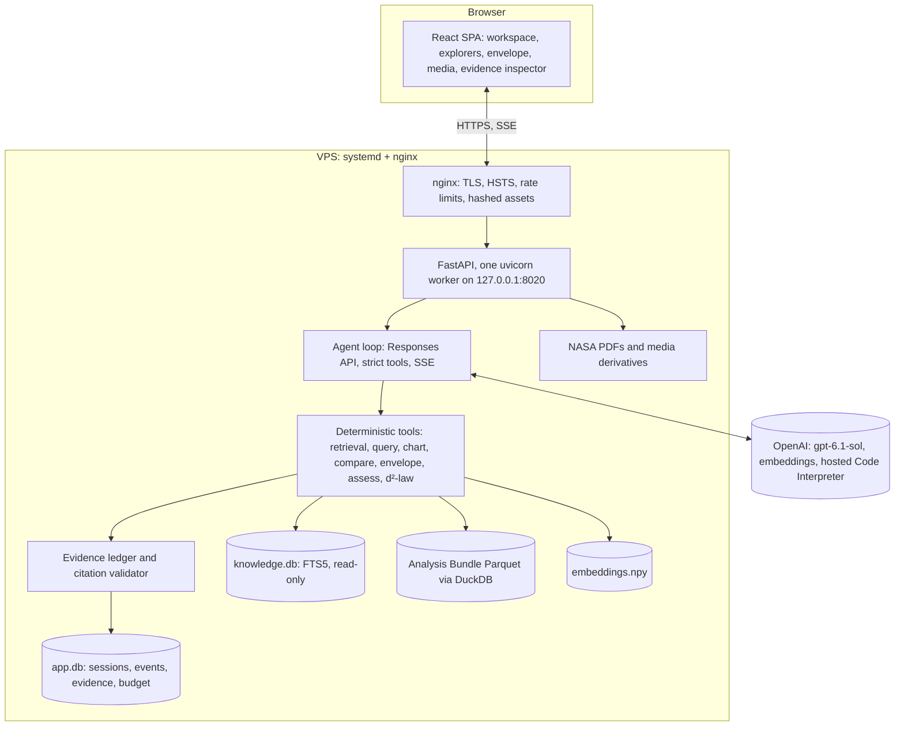

# Architecture overview

This is a short orientation. The canonical documents are [architecture/SYSTEM_ARCHITECTURE.md](architecture/SYSTEM_ARCHITECTURE.md), plus the data, API, agent-tool and frontend docs in [architecture/](architecture/), and the decisions in [decisions/](decisions/).

## Request flows

- **Explorers and tools** (`/api/investigations`, `/api/datasets/*`, `/api/compare`, `/api/envelope`, and others) call the tools directly. No language model is involved and no key is needed.
- **Live research turn** (`POST /api/sessions/{id}/messages`): the budget is reserved first, with per-visitor and daily caps. The agent loop then streams Server-Sent Events: `status`, `tool.started` and `tool.completed`, `evidence.added`, `artifact.created`, `text.delta`, and `turn.completed`. The final text is validated against the ledger and stored with its audit.
- **Recorded demonstrations** (`/api/replays/{id}`) stream stored events. The replay files carry the evidence and artifact records they cite, so citations open even on a fresh deployment.

## Boundaries

- The corpus build (`build/`) is immutable at runtime and opened read-only. Only `app.db` is written.
- The web process never parses uploaded files and never executes generated code. The Analysis Lab runs remotely in an isolated container.
- Secrets exist only in the server environment. The frontend never sees the OpenAI key.
- Writes are rejected when cross-origin. Request bodies are capped at 64 KB, and inputs are validated by Pydantic schemas. Sessions are scoped to an HttpOnly, SameSite=Strict visitor cookie.

## Key decisions

ADR-001 (one agent plus deterministic tools) · ADR-003 (hybrid retrieval, no vector database) · ADR-005 (evidence IDs and validated citations) · ADR-006 (backend-built charts) · ADR-007 (hosted code execution) · ADR-008 (no general predictor; Applicability Envelope instead) · ADR-016 (systemd deployment).
