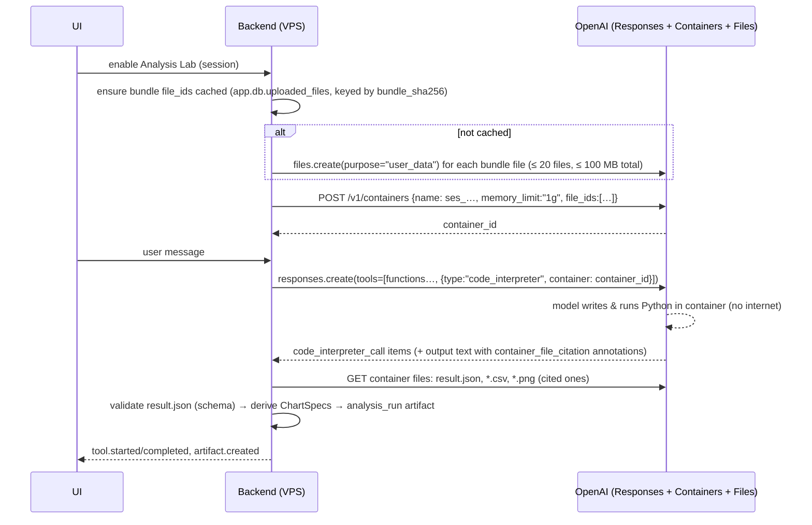

# Code execution: Analysis Lab (P1)

Canonical for: the sandbox architecture, lifecycle, permissions, limits, artifact handling and failure behavior. Rationale: [ADR-007](../decisions/ADR-007-code-execution.md).

## 1. Architecture



**Verify in M9:** confirm the exact Files API `purpose` value and the container-creation fields (`file_ids`, `memory_limit`) against the current OpenAI Code Interpreter and Containers docs before coding. The guide verified on Nov 13 2026 documents `memory_limit` tiers `1g|4g|16g|64g`, `file_ids` in auto mode, and container-file create/list/retrieve endpoints. If explicit-container creation can't attach `file_ids`, add them through the container files endpoint (`file_id` JSON body).

**The trust boundary.** Model-generated code runs **only inside OpenAI-hosted containers**, never on the VPS. The backend never executes, `eval`s or `exec`s model output. It parses JSON and CSV with size limits.

## 2. What the sandbox can access

| Resource | Access |
| --- | --- |
| Analysis Bundle (`runs`, `conditions`, `measurements`, small `series/*` ≤ 20 MB, `bundle_manifest.json`, `README_BUNDLE.md` describing schemas and units) | Read: uploaded to the container at `/mnt/data/` |
| Internet | Not exposed by the Code Interpreter design. We additionally state "no network" in the instructions and never pass URLs |
| Secrets, env vars, VPS filesystem, `knowledge.db`, `app.db` | **None.** Nothing secret is uploaded |
| User uploads | **Not supported** in the MVP. No file upload endpoint exists |

## 3. Lifecycle and limits

- **One container per session**, created lazily on the first Analysis Lab turn, with the 1 GB tier. Store `container_id` and `last_used_at` on the session.
- **Expiry.** OpenAI expires containers after 20 minutes idle. Before each turn, if `now - last_used_at > 18 min` or the API returns not-found or expired, create a new container (the files are re-attached from cached `file_ids`). Tell the model: "Python state was reset; reload data."
- **Limits:**
  - max 4 Analysis Lab turns per session per hour;
  - max 3 `code_interpreter_call`s per turn (enforced by instructions, plus the backend aborting the stream after the 4th call);
  - turn timeout 120 s;
  - downloaded output files: max 5 per turn, 10 MB each;
  - `result.json` ≤ 2 MB.
- **Cost.** $0.03 per 20-minute 1 GB session (Nov 13 2026 pricing), plus model tokens. It counts toward `DAILY_BUDGET_USD`.
- **Cleanup.** Delete the container when the session closes, or by a periodic job after 30 minutes idle. Bundle files persist, reused across sessions, and are deleted when `bundle_sha256` changes.

## 4. Result-file contract (`analysis_result.schema.json`)

The Analysis Lab instructions require the code to write `/mnt/data/result.json`:

```json
{
  "schema_version": "1",
  "question": "string",
  "method": "string (≤ 600 chars, plain language)",
  "inputs": [{"file": "measurements.parquet", "filters": "string", "n_rows": 241}],
  "results": [{"name": "slope_K_vs_XO2_methanol", "value": 1.23, "unit": "mm**2/s", "uncertainty": 0.2,
               "uncertainty_kind": "1-sigma | 95%CI | IQR | none", "n": 57, "note": "string"}],
  "tables": [{"name": "string", "file": "table1.csv", "columns": [{"name": "…", "unit": "…"}]}],
  "charts": [{"title": "…", "chart_type": "scatter|line|bar|box", "data_file": "chart1.csv",
              "x": {"field": "…", "unit": "…"}, "y": {"field": "…", "unit": "…"}, "series_field": "…|null"}],
  "warnings": ["string"]
}
```

**Backend validation:**
- The JSON Schema must validate.
- Every unit must parse in pint.
- Referenced CSVs must exist in the container outputs and be ≤ 10 MB, with ≤ 50k rows.
- Chart CSV columns must match the declared fields.
- Values must be finite.

The backend **builds the ChartSpecs itself** from the CSVs; the code's own PNGs are kept as secondary files labeled "SI-generated image". If validation fails, the artifact is created with `status: "invalid_result"` and errors, and the agent is told to fix the code (one retry), or it explains the failure.

## 5. Reproducibility

The `analysis_run` artifact stores:
- every code cell's text, from the `code_interpreter_call` items;
- stdout/stderr (truncated to 50 KB);
- `result.json`;
- the output file hashes;
- the uploaded input file IDs and their bundle sha256;
- the container memory tier;
- the model and response IDs;
- the package versions, which the instructions ask the code to print as its first step: `import sys, pandas, numpy, scipy; print(versions)`.

The exported zip contains `analysis.py`, the cells concatenated with an SI header comment, plus the README and data references. Anyone can run it locally against `build/bundle/`.

## 6. Failure behavior

| Failure | Behavior |
| --- | --- |
| Files or containers API error | Analysis Lab is disabled for that turn; the agent answers with deterministic tools; the UI shows "Analysis Lab unavailable" |
| Code error in the container | Visible in the artifact logs; the model may retry within its call limit |
| Timeout | The turn is cancelled; a partial artifact is kept with `status: "timeout"` |
| Invalid result | As described in §4 |
| Budget exceeded | Analysis Lab is disabled and the user is told |

## 7. Explicitly rejected

- Executing model code on the VPS, in Docker or in-process.
- Allowing the model to choose arbitrary file IDs.
- Giving the container our API key or any URL.
- Auto-mode containers (`container: {type: "auto"}`), because of the reported creation-cost risk.
