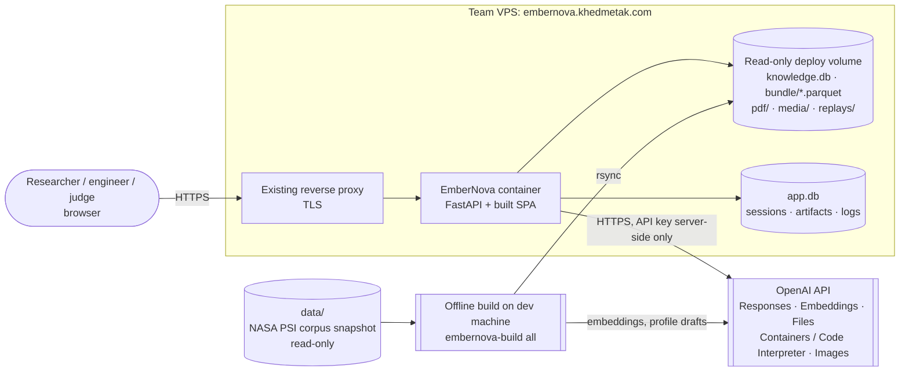
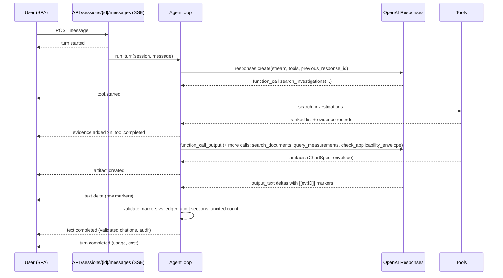

# System architecture

Canonical for: system context, components, deployment boundaries and end-to-end flows. Detailed contracts are in the linked documents.

## 1. System context



- **Users:** anonymous public users, with no authentication. This is a hackathon public demo, protected by a per-IP rate limit and a global daily budget. An optional `ADMIN_TOKEN` header gates the replay-recording and cache endpoints.
- **External services:** OpenAI only. NASA sites are not called at runtime. Source URLs are only rendered as links.
- **Deployment boundary:** one container. The offline build runs on a dev machine with access to `data/`, and only the build outputs are shipped.

## 2. Components

```mermaid
flowchart TB
  subgraph FE["Frontend SPA (Vite/React/TS)"]
    ws[Workspace<br/>Chat · Artifact panel · Evidence inspector]
    exp[Explorers<br/>Investigations · Datasets · Compare · Envelope]
    feat[Featured / Judge Mode]
  end
  subgraph BE["Backend (FastAPI, single process)"]
    api[REST + SSE routers]
    agent[Agent runtime<br/>Responses loop · tool registry<br/>evidence ledger · citation validator<br/>budget guard]
    tools[Tool layer: pure functions]
    retr[Retrieval<br/>FTS5 BM25 · dense cosine · RRF<br/>investigation ranker]
    sci[Science services<br/>units · bundle query · compare<br/>envelope · d2-law · charts]
    media[Media service<br/>range streaming · thumbnails]
    sandbox[Analysis Lab adapter<br/>OpenAI containers]
    store[Storage adapters<br/>knowledge.db (ro) · DuckDB/Parquet (ro) · app.db (rw)]
    replay[Replay recorder / player]
  end
  ingest[Ingestion CLI: embernova-build<br/>catalog · docs/chunks · embeddings · profiles<br/>table parsers + curation YAML · quality checks · media derivatives]
  FE <-->|JSON / SSE| api
  api --> agent --> tools
  api --> tools
  tools --> retr & sci & media & sandbox
  retr & sci & media --> store
  agent --> store
  agent --> replay
  ingest --> store
```

**Design rule.** Every agent tool is a plain Python function in `embernova.tools`. The REST API calls the same function (for example, `POST /api/compare` → `tools.compare_runs`). The Explorer UI and the agent therefore produce identical artifacts. That is what lets Judge Mode and the no-API-key mode work.

Module layout and runtime details: [BACKEND_ARCHITECTURE.md](BACKEND_ARCHITECTURE.md). UI: [FRONTEND_ARCHITECTURE.md](FRONTEND_ARCHITECTURE.md).

## 3. End-to-end flows

### 3.1 Research query



Steps:
1. **Query understanding.** The model itself chooses tools and facet filters from the system prompt's vocabulary. There is no separate classifier.
2. **Search.** Investigation-level search runs first, then chunk-level search within the top investigations.
3. **Retrieval and reranking.** RRF fusion; investigation aggregation; the model reads the top chunks.
4. **Evidence verification.** Each chunk and row is registered in the ledger with a stable ID.
5. **Response.** The answer follows the section template with markers.
6. **Citation validation,** server-side.

### 3.2 Scientific chart

User or agent request → `make_chart(dataset, x, y, color_by, filters)` → the bundle query runs in DuckDB → validation:
- the columns exist;
- units are compatible on each axis;
- the row count is at most 50k, or the data is downsampled with a note.

Then the ChartSpec is built with provenance (query, bundle version, evidence IDs) → the artifact is stored in `app.db` → `artifact.created` → the SPA renders it with Plotly. Hovering a point shows the run row. Clicking opens the row evidence.

### 3.3 Code execution (Analysis Lab, P1)

1. The user enables Analysis Lab for the session, or the agent proposes it and the user approves (one click).
2. The backend ensures bundle `file_ids` exist (uploaded once) and creates or reuses the session container.
3. The agent turn includes the `code_interpreter` tool bound to that container. The model writes and runs Python against `/mnt/data/*.parquet`.
4. On completion, the backend downloads `result.json` and other cited files.
5. The result is validated against `analysis_result.schema.json`. Numbers are tagged `derived`. Charts are re-rendered through ChartSpec.
6. An Analysis Run artifact is created, holding code, logs, files, environment and input file hashes, with an SI badge.
7. Failure or timeout produces a structured error. The agent explains it and falls back to deterministic tools.

Details: [CODE_EXECUTION_SECURITY.md](CODE_EXECUTION_SECURITY.md).

### 3.4 Experiment comparison

The user selects runs, condition groups or investigations → `compare_runs`:
- resolves the runs;
- aligns quantities by canonical name;
- normalizes units to SI and display units;
- computes summary statistics per group (n, median, IQR, min/max);
- evaluates **validity rules** (same quantity definition, same hardware, differing variables, design-vs-measured, gravity regime, fuel and material).

The output is a comparison artifact containing a table, an overlaid chart, a parameter-difference view and a validity checklist with severity. The agent's interpretation must quote the validity verdict. Rules: [SCIENTIFIC_ANALYSIS.md §4](SCIENTIFIC_ANALYSIS.md).

### 3.5 "Prediction" request

The user states a scenario (atmosphere, flow, material, gravity) → `check_applicability_envelope`:
- it parses and normalizes the scenario;
- it finds tests whose conditions bracket the scenario, per variable and jointly;
- it classifies the scenario as `inside_tested_envelope`, `partially_covered` or `outside_envelope`;
- it lists the nearest tests and the gaps.

The agent may then report the measured outcomes of the nearest tests as evidence. It may **not** produce a numerical prediction. The only exception is the P2 droplet model, which is gated, applies to droplets only, and shows uncertainty with an OOD refusal (see [SCIENTIFIC_ANALYSIS.md §6](SCIENTIFIC_ANALYSIS.md)).

## 4. Cross-cutting concerns

| Concern | Where specified |
| --- | --- |
| Provenance and evidence IDs | [DATA_ARCHITECTURE.md §5](DATA_ARCHITECTURE.md) |
| Scientific safeguards | [SCIENTIFIC_VALIDATION.md](SCIENTIFIC_VALIDATION.md) |
| SI labeling | [ARTIFACT_SYSTEM.md §5](ARTIFACT_SYSTEM.md) |
| Performance, cost, rate limits, observability | [BACKEND_ARCHITECTURE.md](BACKEND_ARCHITECTURE.md) |
| Testing and evaluation | [TESTING_STRATEGY.md](TESTING_STRATEGY.md) |
| Operations | [DEPLOYMENT.md](DEPLOYMENT.md) |

## 5. Extensibility hooks (not built now)

- **Experience modules.** `/` is the mission home page with the cinematic introduction ([ADR-015](../decisions/ADR-015-cinematic-frontend.md)). The research workspace is at `/workspace` and `/s/:id`. `/capabilities` and `/how-it-works` explain the system, and the explorers keep their routes (`/systems`, `/evidence-map`, `/investigations`, `/data/:table`, `/compare`, `/envelope`, `/media`, `/featured`, `/about`). Every module reuses the same API and tools.
- **New PSI investigations.** Add a curation YAML and a parser plugin in `embernova.ingest.tables`, then rebuild.
- **New data types,** such as future LUCI or FM2 PSI releases. The `gravity_regime` vocabulary already includes `lunar_surface`, `simulated_partial_g` and `martian_surface`.
