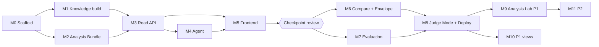

# Codex master plan

This plan is canonical for **what to build, in what order, and how "done" is judged**. Architecture details live in the linked docs; this plan doesn't restate them. When a task says "per X §n", that section is the specification.

**Deadline:** submission closes **Sun Nov 15 2026, 23:59 local**. Everything hinges on the **vertical slice**:

> a real NASA question → relevant investigations → original dataset → verified analysis → interactive artifact → evidence-based answer.

## 0. Schedule and cut lines

| Window | Milestones | Exit condition |
| --- | --- | --- |
| Nov 13 night → Nov 14 midday | M0, M1, M2-FLEX, M3 | `/api/datasets/PSI-69:flex_experimental` returns normalized rows; search works |
| Nov 14 afternoon → evening | M4, M5 | **Checkpoint:** demo question A1 runs end-to-end in the browser with FLEX only |
| Nov 14 night | Claude review → fixes (S1/S2) | Review closed |
| Nov 15 morning | M6, M2-ext (CFI, Saffire-III, BASS-II, FLEX-2), M7-min | Envelope + compare + golden tests green |
| Nov 15 afternoon | M8 deploy, record replays, demo video | Public URL healthy; `/featured` works without the key |
| Nov 15 evening | Buffer → submission by 22:00 | Submitted |
| Only if ahead | M9 Analysis Lab, M10 P1 views | — |
| After the hackathon | M11 (P2) | — |

**Hard cut rules:**
1. If M4 is not working by Nov 14 22:00, ship Explorers, the Envelope and Compare without chat, plus manually recorded replays.
2. If M2 parsers beyond FLEX slip, ship FLEX + CFI only.
3. Never cut citations, provenance or SI labels to save time.

## 1. Dependency graph

---

## M0: Scaffold (≈1.5 h)

**Objective:** a runnable skeleton matching [BACKEND_ARCHITECTURE.md §2](../architecture/BACKEND_ARCHITECTURE.md) and [FRONTEND_ARCHITECTURE.md §5](../architecture/FRONTEND_ARCHITECTURE.md).

**Tasks:**
- **M0.1** `backend/`: `pyproject.toml` (Python ≥3.12,<3.13; dependency groups `dev` and `build`), `uv.lock`, `src/embernova/{main.py, config.py, logging.py}`, `GET /api/health`, `GET /api/meta` (stub), ruff and pytest config, script entry `embernova-build`.
- **M0.2** `frontend/`: Vite + React + TS strict, Tailwind and shadcn init, React Router with all routes from FRONTEND §2 as placeholders, a `/api` dev proxy, Vitest and Playwright config, ESLint.
- **M0.3** Root: `.env.example` with every variable in BACKEND §5; a `Makefile` or `justfile`, plus PowerShell equivalents in `scripts/*.ps1` because the dev machine is Windows; `curation/vocab.yaml` populated from [DATA_ARCHITECTURE.md §4](../architecture/DATA_ARCHITECTURE.md); `docs/implementation/PROGRESS_LOG.md` entries.
- **M0.4** Update the AGENTS.md §4 commands if anything differs (report it in the log).

**Acceptance:**
- `uv run pytest -q` passes (≥ 1 test).
- `npm run build`, `npm run test` and `npm run lint` pass.
- `uvicorn` serves `/api/health`, and the Vite dev server shows the shell with navigation.
- `git status` shows no `build/`, `var/` or `data/` payloads.

---

## M1: Knowledge build (≈5 h)

**Objective:** `build/knowledge.db` per [DATA_ARCHITECTURE.md §6 and §9](../architecture/DATA_ARCHITECTURE.md), steps 1–5 and 8–9.

**Tasks:**
- **M1.1** `ingest/catalog.py`: load investigations, source_files (verified originals only; recompute sha256 and abort on mismatch), publications, relations and hardware. Usability tiers come from [DATASET_AUDIT.md §2](../research/DATASET_AUDIT.md) via a small `curation/tiers.yaml`.
- **M1.2** `ingest/documents.py`: documents and pages from `indexes/DOCUMENT_TEXT.jsonl` and the derived JSONs, with `is_empty`, `doc_type` heuristics and title.
- **M1.3** `ingest/chunks.py`: chunking (≈800 `o200k_base` tokens, 15% overlap, page-aware); context headers; deterministic `evidence_id`; FTS5 (`chunks_fts`, `profiles_fts`).
- **M1.4** `ingest/profiles.py` and `curation/investigations/*.yaml`:
  - `--draft` mode calls `gpt-6-luna` with a prompt that must output YAML following DATA §8.2, with evidence locators drawn only from the supplied pages and metadata.
  - Write drafts for all 34 investigations.
  - Hand-check the 10 priority ones (PSI-69, 68, 39, 159, 25, 26, 98, 99, 100, 101, 102), then set `curation_status: reviewed` only after verifying each locator.
  - The build fails on unresolved locators.
- **M1.5** `ingest/embed.py`: `text-embedding-3-small` at 512 dimensions, batched, with a content-hash cache. `--fake-embeddings` produces a deterministic hash vector, for CI and keyless builds.
- **M1.6** `ingest/media.py`, `curation/media_rules.yaml` and `ingest/pdf.py`: media rows, filename association rules, and ffmpeg derivatives, posters and thumbnails (ADR-011). Copy the cited PDFs.
- **M1.7** `build_info` and the `embernova-build all|catalog|documents|chunks|profiles|embed|media|pdf` subcommands, each idempotent.

**Acceptance:**
- `uv run embernova-build all --fake-embeddings` succeeds from a clean `build/`.
- Counts: 34 investigations; 93 documents; 3,187 pages; 433 ± 5 pages `is_empty`; chunks between 5k and 12k; 39 media items with derivatives for all playable videos.
- Every chunk has a unique `evidence_id`, and rebuilding gives identical IDs (test).
- `SELECT … FROM chunks_fts WHERE chunks_fts MATCH 'burning rate constant'` returns TP-2015-216046 pages.
- The 10 priority profiles are `reviewed`, and their locators resolve.

**Tests:** chunker boundaries, ID determinism, the sha-verification failure path, and the media regex rules. A label extracted from a filename becomes `association=inferred_from_filename` **only if it matches a run label (or alt label) in that investigation's bundle table**. Otherwise the label is stored with `association=none`. Examples:
- `BASS_GMT190_SAMPLE_145_TEST_T21` extracts `T21` (and sample `145`) and links only if BASS-II has run `T21`.
- `udp___LCTF030` extracts `LCTF030`, which has no matching FLEX run label, so it gets `none` with the label kept.

---

## M2: Analysis Bundle (FLEX first ≈2 h; extensions ≈4 h)

**Objective:** Parquet bundle and quality findings per [DATA_ARCHITECTURE.md §7–8](../architecture/DATA_ARCHITECTURE.md) and [SCIENTIFIC_ANALYSIS.md §2–3](../architecture/SCIENTIFIC_ANALYSIS.md).

**Tasks:**
- **M2.1** `science/units.py` (pint registry, display units) and `ingest/tables/cellparse.py` (approx, range, list and embedded-unit parsing).
- **M2.2** `ingest/tables/base.py`: a generic curated-mapping engine driven by `curation/tables/*.yaml`. Handles header row, run key uniqueness, null tokens, `canonical_map`, derived conditions and provenance.
- **M2.3** **FLEX** `curation/tables/PSI-69__flex_experimental.yaml`, exactly as in DATA §8.1.
- **M2.4** `ingest/quality.py`: the checks in SCI §3, including the d²-law.
- **M2.5** Extensions, in order:
  1. CFI table plus DataSummary `DATA` sheet (join on `Flex Number`; parse pressure strings).
  2. Saffire-III 1 Hz telemetry (`SaffireData` and `CygnusData` sheets → `series/`).
  3. BASS-II (gas %, ppm; raw fan settings).
  4. FLEX-2 (design).
  5. Saffire I/II conditions.
  6. SAME-R conditions.
  7. CFI-G normal and inverse (burner-side O₂ label).
  8. ACME Flame Design.
  9. SPICE (dedup).
- **M2.6** `bundle_manifest.json` and DuckDB views (`science/bundle.py`).

**Acceptance:** every golden test in [TESTING_STRATEGY.md §2](../architecture/TESTING_STRATEGY.md) that applies to the parsed tables passes. A bundle build summary prints per-table rows and flags. The `datasets` table in knowledge.db lists each bundle table.

---

## M3: Read API (≈3 h)

**Objective:** every endpoint in [API_CONTRACTS.md §2](../architecture/API_CONTRACTS.md), backed by the tool functions in `embernova/tools/` per [AGENT_TOOLS.md](../architecture/AGENT_TOOLS.md) §1–12. `get_timeseries` may return `not_found` until M2.5 Saffire-III lands.

**Tasks:**
- **M3.1** `storage/knowledge.py`, `retrieval/{fts,dense,fusion,investigations}.py`: the ranker formula and its explanation, per RETRIEVAL §3.
- **M3.2** Tools: `search_investigations`, `get_investigation`, `search_documents`, `get_document_page`, `list_datasets`, `query_measurements`, `make_chart` (ChartSpec builder in `science/charts.py`), `check_d2_law`, `find_media`. Evidence registration uses `agent/evidence.py`, which is created here and usable without a turn.
- **M3.3** `storage/appdb.py` with migrations, and artifact persistence. Routers for read endpoints, evidence and artifacts. Media Range streaming, and file serving by ID only.
- **M3.4** Contract tests: route existence, and responses validated against `docs/architecture/contracts/*.json`.

**Acceptance:**
- `POST /api/search/investigations {"query":"suppression by CO2 and helium dilution of droplet flames", …}` ranks PSI-69 first, with a score breakdown.
- `POST /api/charts` for K vs X_O₂ (FLEX) returns a schema-valid ChartSpec with n ≥ 200 points and exclusions noted.
- `GET /api/media/{FLEX MDCA video}/stream` with `Range: bytes=0-1023` returns 206.
- `GET /api/evidence/{id}` resolves an ID returned by search.
- Everything works with `OPENAI_API_KEY` unset; dense search is skipped with `degraded: bm25_only`.

---

## M4: Agent (≈6 h)

**Objective:** the streaming agent per [AI_ARCHITECTURE.md](../architecture/AI_ARCHITECTURE.md) and the SSE protocol per [API_CONTRACTS.md §3–4](../architecture/API_CONTRACTS.md).

**Tasks:**
- **M4.1** `agent/registry.py`: Pydantic input models → strict JSON Schemas (nullable optional fields), tool descriptions, dispatch.
- **M4.2** `agent/loop.py`: Responses streaming, parallel tool calls, rounds and timeouts, `previous_response_id` chaining with transcript rebuild, fallback model, cancel.
- **M4.3** `agent/prompts/system.md`: write the prompt to the AI §4 spec. Claude reviews it at the checkpoint.
- **M4.4** `agent/citations.py`: validation, audit (AI §6 steps 1–4; step 5 is P1), and evidence-strength computation (SCIENTIFIC_VALIDATION §2).
- **M4.5** `agent/budget.py`: cost accounting from `usage`, the daily budget, the per-IP limiter, and the first-turn answer cache.
- **M4.6** `agent/sse.py`: event models generated from or validated against `sse_events.schema.json`. Store the `sse_events` table for reconnect and replay.
- **M4.7** Offline tests with a scripted fake Responses client: tool dispatch, ordering guarantees, invalid-marker stripping, budget refusal, timeout, provider error → fallback.

**Acceptance:**
- **Offline:** every M4.7 test passes.
- **Live (with key), on question A1:**
  - the stream emits `turn.started` … `turn.completed`;
  - ≥ 3 tools are called, including `search_investigations` and a data tool;
  - `audit.invalid_citations == 0`;
  - the answer has Answer, Evidence and Limits sections;
  - cost is reported.
- A5 returns 0.94 mm with a `data_rows` citation.

---

## M5: Frontend workspace (≈7 h)

**Objective:** the workspace and explorers per [FRONTEND_ARCHITECTURE.md](../architecture/FRONTEND_ARCHITECTURE.md).

**Tasks:**
- **M5.1** API client, SSE parser and typed events (generated types). Stores: session, evidence, artifact, panel.
- **M5.2** Workspace: Conversation, ToolActivity, AnswerRenderer (sections, claim badges, `[n]` citations, audit banner, SI badge), Composer (cancel), suggested questions, follow-ups.
- **M5.3** Right panel: ArtifactViewer (chart via `toPlotly.ts`, table, media, envelope and comparison stubs until M6), EvidenceInspector (page text, PDF iframe `#page=N`, rows viewer, source metadata, copy citation).
- **M5.4** Investigation Explorer and detail tabs (Why-ranked popover); Dataset Explorer (raw ⇄ normalized, quality flags, QuickChart, export).
- **M5.5** About page: sources and DOIs from `/api/meta` and the catalog; the SI disclosure; limitations.
- **M5.6** Visual identity tokens, dark and light themes, a keyboard-shortcuts subset, responsive bottom-sheet panel.

**Acceptance:**
- The A1 question in the browser shows streaming status and tool activity, opens the chart artifact automatically, and every citation opens the correct evidence.
- With no key, Explorers and Dataset charts work, and chat shows the `llm_unavailable` state with a link to Featured.
- Vitest covers the SSE reducer and `toPlotly`.
- Playwright judge flows 1, 3, 4 and 7 pass (flows 2, 5 and 6 come after M6 and M8).

### ▶ Checkpoint (Claude review)

Codex writes the M0–M5 progress entries and stops for review. Claude produces `reviews/CHECKPOINT-review.md`. Fix S1 and S2 before M6.

---

## M6: Comparison and Applicability Envelope (≈4 h)

**Objective:** `compare_runs` and `check_applicability_envelope` per [SCIENTIFIC_ANALYSIS.md §4–5](../architecture/SCIENTIFIC_ANALYSIS.md) and AGENT_TOOLS §8–9. UI: `ComparisonView` with `ValidityChecklist`, `EnvelopeView`, and the `/compare` and `/envelope` pages with presets.

**Acceptance:**
- The verdict tests in TESTING §4 pass.
- The Lunar preset shows FLEX coverage `inside` or `partial` (17 runs at 0.30–0.34 O₂, ≈10.1–10.8 psi) and BASS-II `outside`.
- The gravity note appears for non-µg scenarios.
- CFI-G points are labeled burner-side O₂.
- Playwright flows 5 and 6 pass.

---

## M7: Evaluation (minimum ≈2 h)

**Tasks:**
- `embernova-eval retrieval` (benchmark file `curation/benchmark/retrieval_v1.yaml`; do **not** edit it).
- `embernova-eval agent` covering A1–A8 (create `agent_scenarios_v1.yaml` from TESTING §5).
- A latency and cost report.

**Acceptance:**
- The retrieval report on `dev` and `test` is written to `build/eval/`. Targets are met, or the gap is reported with an analysis.
- Agent scenarios A1, A4 and A5 pass.
- Numbers go in PROGRESS_LOG, and they must be the actual measured values.

---

## M8: Judge Mode, hardening, deploy (≈4 h)

**Tasks:**
- Replay recorder and player (AI §9; `/featured`; the `ReplayPlayer` uses the live reducer).
- Security headers.
- Rate limits verified.
- `deploy/Dockerfile` and `deploy/compose.yaml` per [DEPLOYMENT.md](../architecture/DEPLOYMENT.md).
- `embernova-build deploy-bundle`.
- An nginx/Caddy snippet in `deploy/proxy/`.
- An HF Space variant (`deploy/hf/Dockerfile` that bakes in the data).
- README run and deploy instructions.

**Acceptance:**
- The image is ≤ 400 MB, and RSS under the demo load is ≤ 600 MB.
- `https://embernova.khedmetak.com/api/health` is ok.
- Three replays are recorded and play with the key unset.
- Every Playwright judge flow passes against the deployed URL.
- SSE works through the proxy, with no buffering and a heartbeat seen.

---

## M9: Analysis Lab (P1, ≈5 h)

Per [CODE_EXECUTION_SECURITY.md](../architecture/CODE_EXECUTION_SECURITY.md).

**Start with a 30-minute smoke test:** `code_interpreter` with `gpt-6.1-sol`, an explicit container with file IDs, writing and reading back `result.json`. Record the outcome in the log. If it fails, switch the model per AI §2 or stop and report.

**Acceptance:**
- "Fit K vs X_O₂ for methanol and heptane in FLEX air-diluted tests" yields a valid `analysis_run` artifact with re-rendered charts, an SI-code badge, and an exportable `analysis.py`.
- An invalid `result.json` produces the `invalid_result` state.
- The container is reused within 18 minutes and recreated afterwards.

## M10: P1 views (≈5 h)

- Saffire-III timeline (`get_timeseries`, LTTB).
- Research-gap shading on the envelope.
- Relationship view: investigation ↔ hardware ↔ publication, from SQL.
- Numeric-grounding audit (AI §6.5).

Each has a demo-able acceptance check written in the log.

## M11: P2 (after the hackathon)

- The gated droplet model (SCI §6, with the gate report).
- SI illustrations (ARTIFACT §5, with watermark tests).
- OCR of empty pages.

---

## Definition of done (every milestone)

1. Acceptance criteria are met, with evidence in PROGRESS_LOG.
2. Tests and linters are green, with the actual output pasted.
3. No secrets or `data/` payloads are committed.
4. Docs drift is reported: any deviation becomes a `PROPOSAL:` entry, never a silent change.
5. UI work includes screenshots in `build/eval/screens/`, referenced in the log.
