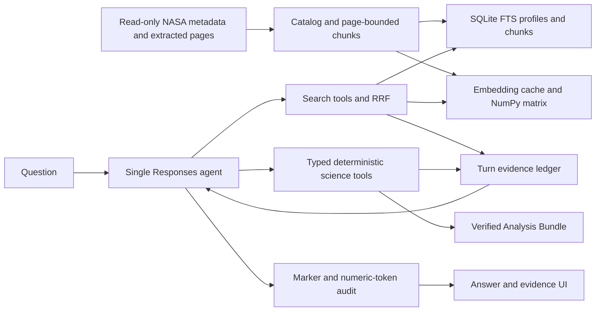
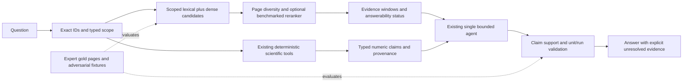

# AI retrieval and agent research audit

## What does the implementation actually do, and what is verified?

### Takeaway
The single-agent/typed deterministic tools design is appropriate. Retrieval is a real hybrid implementation, but offline relevance rejection and citation/numeric assurance have important demonstrated weaknesses. No live model call or paid embedding request was made during this audit.

### Cited Findings
- Current retrieval uses FTS5 Porter/unicode61, OR token queries, 512-dimensional normalized embedding dot products, and reciprocal rank fusion with k=60. Investigation ranking fuses metadata lexical, metadata dense, and passage-derived investigation lists. Availability has zero default weight; optional objective tags receive a 0.3 weight against 0.7 text weight. Source: `backend/src/embernova/retrieval.py:45,89,169,188,203,209`; `config.py:15`.
- Agent uses configured `gpt-6.1-sol`, fallback `gpt-6.1-terra`, medium reasoning, six tool rounds plus final synthesis, strict Pydantic function schemas, per-turn ledger, Responses streaming, 120-second turn timeout, bounded costs, no framework orchestration. Source: `config.py:13`; `agent/loop.py:66`; `agent/registry.py:111`.
- Executed `backend/.venv/Scripts/python.exe -I -m pytest backend/tests/test_agent.py backend/tests/test_citation_formats.py -q --basetemp=build/state-of-the-art-audit/pytest-ai`: **9 passed, 1 warning in 1.81 s**. Warning: Starlette TestClient httpx deprecation. Tests use scripted provider, not a live model.
- Executed `backend/.venv/Scripts/python.exe -I build/state-of-the-art-audit/ai_probe.py` with `_env_file=None, openai_api_key=None` and isolated state. Raw reproducible outputs: `build/state-of-the-art-audit/ai-probe-results.json`. No source changes.

| Offline BM25-only split | n | Recall@5 | Precision@5 | MRR (returned top15) | nDCG@10 | mean ms | nearest-rank p95 ms |
|---|---:|---:|---:|---:|---:|---:|---:|
| dev | 20 | .608333 | .420000 | .846667 | .791064 | 609.517 | 970.024 |
| test | 10 | .673810 | .460000 | .933333 | .681703 | 366.210 | 449.962 |

This tests the shipped fallback, not hybrid quality. Latency is one sequential local run including evidence ledger work, not production load. No tuning followed test execution. Ground truth is architect-authored, 30 investigation queries; only one has page labels. Claims of citation coverage or scientific answer accuracy cannot be inferred from investigation MRR. Recall@5 is structurally capped below 1 on queries with more than five relevant investigations; report ceilings when comparing acceptance targets.

### Adversarial results (actual execution)

| Scenario/query | Observed top results or audit | Interpretation |
|---|---|---|
| Supported: heptane methanol droplet burning rate constant | PSI-69, PSI-68, PSI-117 | Sensible candidate retrieval; not answer verification |
| Complex: compare smoke detection in SAME and Saffire | PSI-101, PSI-98, PSI-99, PSI-100, PSI-102 | Both families retrieved; comparability not established by ranking |
| Numeric: FLEX test 20CAL10 extinction diameter | PSI-117, PSI-69, PSI-68 | Named FLEX target not first; exact test identity needs structured routing |
| Contradiction: visible extinction versus continuing cool flame | PSI-39, PSI-117, PSI-69 | Candidate evidence retrieved; no contradiction adjudication executed |
| Insufficient: exact lunar fire probability for cotton at 32% oxygen | GRC-PARTIAL-G, LUCI, PSI-98 | Relevant documents do not make requested probability answerable |
| Ambiguous: safest spacecraft material | PSI-98, PSI-25, PSI-100 | Clarification/limits required; not a material safety ordering |
| Citation: NASA TP 2015 216046 burning rate units | PSI-69 first | Document identity plausible; page accuracy needs separate assessment |
| Specialized: radiative extinction opposed flow quenching | PSI-26, PSI-25 | Appropriate candidates in fallback |
| Irrelevant: best pizza restaurant near me | PSI-68 first, score .947159, no_match=false | Confirmed fallback relevance failure |
| Malformed: quoted OR/NEAR/DROP TABLE text | No exception; PSI-10 first, score .991935 | SQL did not execute; irrelevant text still yields high rank score |

Numeric validator probes with a controlled fixture containing extinction diameter **0.94 mm** all returned zero invalid citations, zero mismatches, zero uncited sentences, and zero ungrounded numbers for: **0.94 metres**, **-0.94 mm**, **pressure 0.94 mmHg**, **999 mm** when 999 appears only in user question, and **888 mm** when 888 appears only in an unrelated tool output. The uncited assertion “All spacecraft materials are safe in lunar gravity” also returned all zeros. An uncited numeric sentence returned uncited_sentences=1 but ungrounded_numbers=0. These are real validator executions, not observed model hallucinations. Source: `agent/citations.py:33,56,121`; reproduction script above.

### Inferences
- High priority: distinguish citation existence, numerical token occurrence and semantic entailment in UI/report language. A clean current audit is not verification of scientific claims.
- Keyless fallback must not inherit confidence-like score presentation. RRF measures order agreement, not calibrated relevance or answerability.
- Preserve single agent and deterministic science. Fix evidence correctness before replacing models or adding agents.

### Gaps
Live model performance, hybrid benchmark and account-specific provider model access remain untested. Public model documentation was subsequently verified below; billing was not exercised.

## Which research alternatives are justified for this workload?

### Takeaway
Local task-specific evaluation is more important than a new retriever name. Primary sources verified so far support benchmarking rerankers and reasoning-aware query reformulation, not unconditional replacement.

### Cited Findings
- [BEIR: A Heterogenous Benchmark for Zero-shot Evaluation of Information Retrieval Models](https://arxiv.org/abs/2104.08663), Nandan Thakur, Nils Reimers, Andreas Rücklé, Abhishek Srivastava, Iryna Gurevych; NeurIPS 2021 Datasets and Benchmarks. Heterogeneous evaluation demonstrates the need to test beyond one training domain. It does not establish NASA retrieval superiority for any new model.
- [ColBERTv2: Effective and Efficient Retrieval via Lightweight Late Interaction](https://aclanthology.org/2022.naacl-main.272/), Keshav Santhanam, Omar Khattab, Jon Saad-Falcon, Christopher Potts, Matei Zaharia; NAACL 2022. Token-level multi-vector matching with residual compression and denoised supervision. Worth an offline benchmark; extra index/inference complexity is not justified yet for a small corpus.
- [M3-Embedding: Multi-Linguality, Multi-Functionality, Multi-Granularity Text Embeddings Through Self-Knowledge Distillation](https://arxiv.org/abs/2402.03216), 2024 preprint, revised 2025; combines dense, sparse and multi-vector retrieval. Candidate experiment, not evidence that it beats current 512-dimensional embeddings on combustion reports.
- [BRIGHT: A Realistic and Challenging Benchmark for Reasoning-Intensive Retrieval](https://arxiv.org/abs/2407.12883), Hongjin Su and colleagues, 2024 preprint revised 2025. Contains 1,384 queries; original evaluation showed major degradation relative to ordinary retrieval benchmarks. Useful motivation for difficult mechanism/condition queries; external scores do not transfer to EmberNova.
- [ReasonIR: Training Retrievers for Reasoning Tasks](https://arxiv.org/abs/2504.20595), Rulin Shao and colleagues, 2025; [COLM 2025 paper](https://openreview.net/pdf/08ca247ba1def28f58c2066c936038f437578e07.pdf). Reasoning-oriented retriever training is a long-term candidate; an 8B retriever is not a default fit for the shared VPS.
- [Enabling Large Language Models to Generate Text with Citations](https://arxiv.org/abs/2305.14627), Tianyu Gao and colleagues; EMNLP 2023. ALCE separates correctness and citation quality; appropriate framework for auditing claim-level support beyond valid ledger IDs.
- [Superintelligent Retrieval Agent: The Next Frontier of Agentic Retrieval](https://arxiv.org/abs/2605.06647), Zeyu Yang and colleagues, May 2026 preprint revised August 2026. Verified existence and metadata; full empirical applicability remains to inspect. Its title is not evidence of superiority.

### Inferences
Test BM25, present hybrid, hybrid plus a cross-encoder, and a query-expansion ablation under identical page labels, cost ceilings and abstention requirements. Keep structured scientific SQL separate from semantic retrieval.

### Gaps
No alternate model has been run locally. Literature records and detailed migration guidance are being completed; no benchmark gain is asserted.

## What should change before and after submission?

### Takeaway
Immediate priorities are honest audit labels, robust keyless retrieval, expanded page-level gold evidence, and exact identifier routing. Learned retrievers and new orchestration belong behind experiments after the deadline.

### Cited Findings
Source inspection identifies stale canonical retrieval descriptions: min-max normalization and availability boosts described in `docs/architecture/RETRIEVAL_ARCHITECTURE.md` are replaced in code; aliases, sentence-boundary clipping and adjacent chunk merging described there are not implemented in `ingest/documents.py` / `retrieval.py`. `docs/judging-review/12_REVIEW_UPDATE.md` itself says the changed ranking benchmark was not rerun.

### Inferences
Recommended architecture: preserve monolith, SQLite/FTS and NumPy exact vectors; add stable typed claim-to-evidence bindings, deterministic query intent/identifier parsing, explicit query-level answerability, page-level retrieval evaluation, then optional reranking after a measured gain. No graph database, multi-agent framework or vector service is currently justified.

### Gaps
No production implementation changes were made. The following completed details supplement these notes.

### Completed implementation coverage and recommendation matrix

All paths below are relative to `backend/src/embernova/` unless otherwise specified. Difficulty/effort estimates are reviewer estimates for one engineer, not commitments. Confidence describes evidence for the finding, not a measured improvement from an unrun replacement.

| Feature and purpose | Current implementation and evidence | Limitations / missing checks | Strong alternatives | Decision and concrete recommendation | Benefit / risk | Difficulty; confidence; priority |
|---|---|---|---|---|---|---|
| Query sanitization | `retrieval.py:45`: ASCII alphanumeric tokens, stoplist, quoted OR | Loses Unicode chemical notation, phrases, negation and unit structure; SQL-safety probe passed | phrase+OR; domain alias expansion; structured query parser | IMPROVE: normalize Unicode and aliases into separate recall channel, preserve original query and exact test-ID route | Better scientific terminology; expansion can broaden wrong senses | Low; High; High |
| Profile search | `retrieval.py:177`, `ingest/documents.py`: FTS over original metadata | No reviewed synthesized profiles; fixed metadata fields omit some schema facets | metadata BM25; reviewed structured profiles; learned sparse | KEEP baseline; benchmark curated title/acronym/hardware aliases separately | Cheap and competitive measured baseline; curation cost | Low; High; High |
| Passage lexical retrieval | `retrieval.py:95`: weighted FTS BM25 top50 | Broad OR common terms; no relevance rejection offline | phrase+OR; learned sparse SPLADE; domain term expansion | IMPROVE lexical query handling before neural rewrite | Better keyless reliability; precision/recall tradeoff | Low/Medium; High; High |
| Dense retrieval | `dense.py:25`: normalized NumPy exact dot products | Synchronous external embedding; global top50 then scoped filtering; no model benchmark | larger OpenAI embeddings; BGE-M3; ColBERTv2/ReasonIR | KEEP exact matrix; EXPERIMENT model swaps after labels | No vector service needed for 3,495 chunks; larger models cost more | Medium; High for scale fit, Low for gain; Medium |
| Embedding persistence | `ingest/embeddings.py:12`; content/model/dim hash cache, finite normalized vectors | Runtime stale check uses mtime despite stored knowledge SHA; missing atomic matrix+manifest pair publication | hash-version directory; atomic pointer swap; vector service | IMPROVE versioned immutable build directory and verify hash on startup | Reproducible index; minimal infra risk | Low/Medium; High; Medium |
| Dense query cache | `dense.py:47`: process Store dictionary, clears all at 512 | Not LRU despite docs; concurrent same query can duplicate API calls; synthetic shared IP budget | locked bounded LRU; per-key singleflight; persistent cache | IMPROVE singleflight + actual LRU; keep bounded | Latency/cost reliability; lock complexity | Low; High; Medium |
| Investigation RRF | `retrieval.py:188`: profiles + one aggregated passage list | Three strongest chunks favor report-rich investigations; grade confidence not calibrated | weighted RRF; convex score fusion calibrated on dev; learning-to-rank | KEEP RRF baseline, EXPERIMENT passage weight/objective using fresh held-out labels | Measured recall tradeoff; 30 labels too few for LTR | Low; High; High |
| Objective ranking | `retrieval.py:219`: fraction tags matched, 0.3 weight | Heuristic preference not physics; API calls it filter though it reranks | hard metadata filter; preference rerank; constrained Pareto presentation | IMPROVE distinguish filter vs preference, expose both; zero availability weight remains | Intent transparency; users may expect exclusions | Low; High; High |
| Relevance rejection | `retrieval.py:105,183`: max cosine floors .45/.35 | Global profile veto can discard an exact lexical match; disabled on provider outage; threshold sampled on small benchmark | query lexical diagnostic gate; per-candidate calibrator; reranker abstention | IMPROVE keyless lexical gate and abstention tests; tune calibrated candidate gate later | Demonstrated pizza failure removed; over-rejection risk | Medium; High; High |
| Scope detection | `retrieval.py:8,160`: propulsion regex notice | Only detects listed propulsion words; not general no-answer detector | domain intent rules; small classifier; model routing | KEEP notice, separate corpus relevance from scientific answerability | Avoids pretending relevant docs answer unsupported requests | Low; High; Medium |
| Metadata-scoped retrieval | `retrieval.py:98,114`: lexical prefilter, dense global top50 postfilter | Scoped dense candidates can be absent from global top50 though best within scope; dense floor considers global score | dense mask before topK; per-investigation index; overfetch | IMPROVE mask before sorting over existing matrix | Exact fix without new service; add scoped recall regression | Low; High; High |
| Passage context | `retrieval.py:153`: first1200 chars; `Ledger.add` first2000 | Relevant evidence after prefix can be omitted; no adjacent merge or sentence clipping | query-focused windows; parent-page expansion; structural chunks | IMPROVE return matched sentence spans plus page locator and complete-page tool | Avoid missing qualifier/value; offsets must stay source-exact | Medium; High; High |
| Full page tool | `retrieval.py:52`; `agent/loop.py:64` truncates strings1600 | Tool returns full page internally but model gets prefix; excerpt first1600 too | offset/limit cursor; passage window API; paginated page parts | IMPROVE cursor/offset and explicit total length/truncation metadata | Reach evidence near page end without huge context | Low/Medium; High; High |
| Chart/measurement routing | `agent/registry.py:42,52`, `tools.py:197,281` | Generic field strings; model must learn schema then avoid invalid units | dynamic dataset enums; dataset-specific typed calls; deterministic intent templates | IMPROVE dataset schema examples and field constraints, retain backend checks | Fewer invalid tool calls; schema growth | Low; High; High |
| Media lookup | `tools.py:413`: exact metadata filters, storage order then limit | No relevance ranking, not semantic video understanding | exact association first; metadata BM25; multimodal embedding | KEEP deterministic filter; improve explicit stable association priority if useful | Avoid invented run/media links; no justified multimodal upgrade | Low; High; Low |
| Agent orchestration | `agent/loop.py:66`: one bounded manual Responses loop | Testing covers scripted paths; no comprehensive real-task repeatability | deterministic workflow templates; workflow graph; multi-agent delegation | KEEP single agent; add templates only for repeated failures | Simpler traceable state; premature graph adds failure surfaces | Low; High; High |
| Tool schemas | `agent/registry.py:167`: recursively strict JSON schema and extra=forbid | Schema legality is not scientific argument validity; Range lacks min<=max here; unbounded lists | semantic validators; finite/range constraints; generated schema from bundle | IMPROVE cross-field semantic validation before calls | Clear errors, less waste; validation duplication | Low; High; High |
| Tool-call completion | `agent/loop.py:353`: iterates calls[:10] | More than10 function calls silently receive no output; next provider request may reject unresolved calls | reject excess with output per ID; constrain provider; batch tool | IMPROVE send bounded error output for every excess call | Deterministic recovery; rare-path test needed | Low; High (static); Medium |
| Cancellation/timeouts | `agent/loop.py:368`: wait_for(to_thread(...),20) | Thread can continue after timeout/cancel and mutate shared ledger/state | cooperative cancellation; isolated immutable result then commit; process isolation | IMPROVE compute result locally and publish only when turn active | Prevent late evidence race; more lifecycle code | Medium; High (static); Medium |
| Streamed prose | `agent/loop.py:211,325`: text.delta before validation | Incorrect numeric prose can be displayed before audit; intermediate round prose accumulates | final-only checked prose; provisional label; structured claim streaming | IMPROVE visibly provisional streaming, final atomic validated answer | Honest assurance; can reduce perceived streaming immediacy | Low; High; High |
| Numeric grounding | `agent/citations.py:33,56`: token matching across cited/question/tool values | Executed wrong-sign/unit/quantity/source probes pass | typed claim binding; deterministic numeric snippets; NLI-assisted prose review | REPLACE assurance role with quantity/run/unit/source binding; retain heuristic only as diagnostic | Scientific safety; structured generation integration risk | Medium/High; High; Critical |
| Citation validation | `agent/citations.py:83`: ledger membership, kinds, line heuristic | Valid ID does not establish entailment; general uncited claims bypass regex | ALCE-style human labels; claim-evidence NLI; typed assertions | IMPROVE claim segmentation and coverage evaluation; no automatic truth badge | Better attribution accuracy; automated NLI itself fallible | Medium; High; Critical |
| Evidence-strength badge | `agent/citations.py:134`: >=3 rows plus document = strong | Sample count+doc count says nothing about independence, controls, uncertainty or relevance | coverage labels; dimension checklist; reviewed evidence grading | REPLACE strong/moderate with factual “rows + publication” coverage labels | Removes unsupported quality ranking; little cost | Low; High; High |
| Context compaction | `agent/loop.py:24`: every list first12, string1600; artifact key allowlist | Selection omits later rows/conditions without per-field counts; some artifact payload details absent | schema-aware summaries; pagination; explicit coverage map | IMPROVE typed compact views with totals, omitted fields and retrieval cursors | Preserves limits and completeness; tool schema work | Medium; High; High |
| Turn memory | `agent/loop.py:99`: last6 historical answers, new per-turn ledger | Old [n] citations unresolved in new ledger; prior answers can anchor new false claims | evidence-backed summary state; reload cited evidence; no historical factual context | IMPROVE preserve provenance pointers and explicit revalidation for follow-ups | Better multi-turn grounding; context cost | Medium; High; Medium |
| Budgeting | `agent/budget.py:26,50`, `agent/loop.py:151` | Byte length treated as token estimate; accumulated input billed repeatedly is conservative; fallback cost uses primary prices | tokenizer estimate; model price table; provider usage reconciliation | KEEP reservation safety; IMPROVE per-model rates and explicit estimate semantics | Budget usability; don't weaken hard caps before verified accounting | Low; High; Medium |
| Model selection | `config.py:13`: Sol primary/Terra fallback | No controlled evidence that primary is optimal; fallback actual model not reflected in turn.started | Terra; Sol effort variants; Astra for offline ceiling experiment | KEEP configured model for deadline; EXPERIMENT blind repeated tasks | Avoid destabilizing rewrite; alternatives unproven | Medium; Medium; Medium |
| Hosted Analysis Lab | `sandbox.py:29,58`: allowlisted CSVs, hosted1GB/no-network, result schema | Shape/units/input names don't validate arithmetic or fitted model; default disabled | deterministic analyses; vetted code templates; arbitrary exploratory sandbox | KEEP disabled default; retain exploratory label and independent recomputation | Useful advanced analysis only after scientific validation | High; High; Low before deadline |
| Evaluation CLI | `evaluation.py:18`:30 queries, R@5/MRR/nDCG; mode inferred from file+key | One page label; no precision/negative queries/repeated runs; hybrid label can lie if dense degraded | expanded expert gold; mode-per-query logging; paired ablations | IMPROVE benchmark evidence before algorithm swaps | Makes improvements falsifiable; annotation time | Medium; High; Critical |
| Featured demos | `evaluation.py:102`: deterministic scripts and clear replay origin | Not live-model reliability proof; stale artifacts possible | refreshed scripted walkthrough; live recorded snapshot; static demo | KEEP honest origin, regenerate only on final bundle in implementation task | Judge resilience; avoid presenting script as AI run | Low; High; High |

### Additional actual ablation and limits

Executed `backend/.venv/Scripts/python.exe -I build/state-of-the-art-audit/retrieval_ablation.py`. Output is `build/state-of-the-art-audit/retrieval-ablation-results.json`. These are raw lexical ablations on the same 30 questions, no weights fitted. Profile-only uses the existing metadata FTS ranking; best-passage-only ranks each investigation by its earliest chunk in the top50 lexical chunks, deduplicating investigation IDs. Both return at most15 like the shipped investigation method.

| Method | Split | Recall@5 | Precision@5 | MRR@15 | nDCG@10 |
|---|---|---:|---:|---:|---:|
| Shipped BM25 fallback fusion | dev | .608333 | .420000 | .846667 | .791064 |
| Profile only | dev | .788333 | .500000 | .933333 | .841365 |
| Best passage only | dev | .546667 | .390000 | .741667 | .639447 |
| Shipped BM25 fallback fusion | test | .673810 | .460000 | .933333 | .681703 |
| Profile only | test | .728571 | .480000 | .875000 | .656177 |
| Best passage only | test | .542857 | .360000 | .770000 | .507827 |

Profile-only improves recall but lowers test MRR and nDCG relative to shipped fusion. This is evidence against assuming more retrieval channels always help, not grounds for silently replacing fusion. The test set has now been inspected: future tuning requires fresh holdout queries. Aggregate maximum Recall@5 given label cardinality is .975 dev and .938095 test; the .85 target remains feasible but query-level perfect recall does not. Gold-page hit@8 was **1/1** on q01; no test page labels exist, so no general passage-recall conclusion is defensible.

Database counts:34 investigations,93 documents,3187 pages,3495 chunks. Measured knowledge SHA-256 `cf8b54994729bc55b32fcb3f9cfc5067ae651a4fb7c8e58cdcb28733482a46db`. At 512 float32 dimensions,3495 chunk vectors alone occupy7,157,760 bytes, about6.83MiB (calculated from measured chunk count and configured dimensions), so exact NumPy search is an appropriate design. Actual matrix may also contain profiles; no ANN service justified on footprint grounds.

### Completed research records and applicability

Read verified primary abstract/metadata pages and official docs; full-paper methodological reproduction was not performed. External benchmark numbers below are author-reported, not replicated and never presented as EmberNova gains. Research coverage prioritizes relevant2024–2026 work but retains strong foundations. A survey cannot prove no better paper exists as of November2026.

| Exact title / authors / year / status / identifier | Contribution and verified empirical evidence | Limitations for EmberNova | Proposed experiment / estimated effort |
|---|---|---|---|
| **BEIR: A Heterogenous Benchmark for Zero-shot Evaluation of Information Retrieval Models**; Nandan Thakur, Nils Reimers, Andreas Rücklé, Abhishek Srivastava, Iryna Gurevych;2021; NeurIPS Datasets and Benchmarks; [arXiv:2104.08663](https://arxiv.org/abs/2104.08663) | Heterogeneous zero-shot benchmarking; supports strong lexical and reranking baselines rather than dense-only assumptions | No combustion-specific labels; older model comparison | Adopt stratified eval protocol, not its leaderboard winner;1–2 days plus annotation |
| **ColBERTv2: Effective and Efficient Retrieval via Lightweight Late Interaction**; Keshav Santhanam, Omar Khattab, Jon Saad-Falcon, Christopher Potts, Matei Zaharia;2022; NAACL; [10.18653/v1/2022.naacl-main.272](https://aclanthology.org/2022.naacl-main.272/) | Residual-compressed token vectors with denoised supervision; paper reports reduced space versus earlier late interaction | Adds inference/index dependencies; exact-ID needs remain | Offline candidate recall comparison on same chunks;2–5 days; EXPERIMENT |
| **SPLADE v2: Sparse Lexical and Expansion Model for Information Retrieval**; Thibault Formal, Carlos Lassance, Benjamin Piwowarski, Stéphane Clinchant;2021 preprint; [arXiv:2109.10086](https://arxiv.org/abs/2109.10086) | Learned sparse expansion, pooling and distillation; abstract reports >9% nDCG@10 gains on TREC DL2019 over earlier SPLADE | Learned vocabulary expansion can miss rare NASA symbols; requires new model inference | Compare sparse retrieval to existing FTS and hybrid;2–4 days; EXPERIMENT |
| **M3-Embedding: Multi-Linguality, Multi-Functionality, Multi-Granularity Text Embeddings Through Self-Knowledge Distillation**; Jianlv Chen, Shitao Xiao, Peitian Zhang, Kun Luo, Defu Lian, Zheng Liu;2024 preprint revised2025; [arXiv:2402.03216](https://arxiv.org/abs/2402.03216) | Joint dense/sparse/multi-vector model, >100 languages, up to8192-token inputs; reports multilingual/long-document benchmark gains | Mostly English small NASA corpus may not benefit; CPU deployment cost unmeasured | Offline embedding comparison; avoid serving all three modes by default;2–4 days |
| **BRIGHT: A Realistic and Challenging Benchmark for Reasoning-Intensive Retrieval**; Hongjin Su, Howard Yen, Mengzhou Xia, Weijia Shi, Niklas Muennighoff, Han-yu Wang, Haisu Liu, Quan Shi, Zachary S. Siegel, Michael Tang, Ruoxi Sun, Jinsung Yoon, Sercan O. Arik, Danqi Chen, Tao Yu;2024 preprint revised2025; [arXiv:2407.12883](https://arxiv.org/abs/2407.12883) |1384 reasoning-intensive queries; original leading MTEB model scored18.3 nDCG@10 on BRIGHT despite59.0 MTEB; reported reasoning gains up to12.2 points | Different domain and retriever generation; not a direct NASA performance prediction | Add mechanism, confounding and negative-control query strata;1–3 days annotation |
| **ReasonIR: Training Retrievers for Reasoning Tasks**; Rulin Shao, Rui Qiao, Varsha Kishore, Niklas Muennighoff, Xi Victoria Lin, Daniela Rus, Bryan Kian Hsiang Low, Sewon Min, Wen-tau Yih, Pang Wei Koh, Luke Zettlemoyer;2025; COLM paper verified above; [arXiv:2504.20595](https://arxiv.org/abs/2504.20595) |Synthetic hard queries/negatives; reports29.9 nDCG@10 BRIGHT without reranker,36.9 with reranker |8B retriever is expensive for shared CPU VPS; synthetic-domain transfer unknown | Offline ceiling experiment only after hard-query labels;3–7 days plus compute |
| **Superintelligent Retrieval Agent: The Next Frontier of Agentic Retrieval**; Zeyu Yang, Xu Han, Qi Ma, Jason Chen, Anshumali Shrivastava;2026 preprint; [arXiv:2605.06647](https://arxiv.org/abs/2605.06647) |Corpus-statistic-validated query/document expansion followed by weighted BM25; author claims strongest average in their ten-BEIR comparison; BrowseComp-Wikipedia R@10=15.27% |Preprint, comparison-specific; huge Wikipedia search differs from34 investigations; generated expansion is not source evidence | Test constrained vocabulary expansion from curated aliases first; full approach3–7 days; speculative transfer |
| **Enabling Large Language Models to Generate Text with Citations**; Tianyu Gao, Howard Yen, Jiatong Yu, Danqi Chen;2023; EMNLP; [arXiv:2305.14627](https://arxiv.org/abs/2305.14627) |ALCE separates fluency/correctness/citation quality; best tested models lacked complete ELI5 support50% of the time |Historical model results not current-model accuracy; automated entailment metrics need human review | Claim-level expert support labels;1–3 days starter set; immediate relevant evaluation principle |
| **Lost in the Middle: How Language Models Use Long Contexts**; Nelson F. Liu, Kevin Lin, John Hewitt, Ashwin Paranjape, Michele Bevilacqua, Fabio Petroni, Percy Liang;2023 preprint, TACL2024; [arXiv:2307.03172](https://arxiv.org/abs/2307.03172) |Position-dependent performance in multi-document QA/key-value retrieval |Cannot assume identical effect in current Sol; context truncation here is already a deterministic issue | Position-permutation and late-page evidence tests;0.5–1 day fixtures |
| **τ-bench: A Benchmark for Tool-Agent-User Interaction in Real-World Domains**; Shunyu Yao, Noah Shinn, Pedram Razavi, Karthik Narasimhan;2024 preprint; [arXiv:2406.12045](https://arxiv.org/abs/2406.12045) |End-state checks and pass^k repeated reliability; original agents <50% success, retail pass^8<25% |Retail/airline policy tasks and simulated users differ from science | Repeated task success with deterministic evidence/tool expectations;2–3 days harness; paid runs separately budgeted |

ToolSandbox was searched but repeated primary-page fetches timed out; it is not used as a substantive evidence basis. LongCite2025 surfaced in search but was not fully inspected; no claimed upgrade depends on it. This explicitly limits the literature coverage rather than padding the bibliography.

### Official model/API verification and model-comparison design

[Sol official model page](https://developers.openai.com/api/docs/models/gpt-6.1-sol.md) verifies model ID, Responses tool use, streaming/structured outputs, 1,050,000 context and standard $2 input/$0.10 cached/$10 output per million tokens. [Terra official model page](https://developers.openai.com/api/docs/models/gpt-6.1-terra.md) verifies Responses tools and $1/$0.05/$5 rates. Both list code_interpreter support. These are provider capability/pricing facts, not independent scientific QA results. Regional, service-tier, cache-write and long-context fees exist; current config models only three token rates. The configured150k turn budget is below the documented272k long-context surcharge threshold, though accounting needs to include the actual request history. Published million-token capacity does not resolve truncation in `compact()`.

Keep Responses strict function calling: [official function-calling documentation](https://developers.openai.com/api/docs/guides/function-calling) matches required fields and additionalProperties=false conversion. Strict schema proves syntactic conformance, not physical correctness or correct field selection.

Recommended model experiment (not executed): pin returned model identifiers, SDK version, prompt hash, tool schemas, corpus hash and reasoning settings; compare Terra-medium, Sol-medium, Sol-high, and optional Astra ceiling only if available/budgeted. Use at least20 expert scenarios stratified by supported numeric, conditions-only, contradictory terminology, no evidence, partial gravity, exact IDs, malicious source text and multi-turn corrections. Run3 repetitions each initially, randomize model order, cache identical deterministic tool outputs, score task completion and claim support manually blinded. Report tool argument rejection/recovery, exact numeric/units/run correctness, source-page precision, citation completeness, unjustified claim count, abstention accuracy, p50/p95 latency, tokens and actual billed cost. Choose a Pareto-efficient model only if it meets scientific reliability gates. One smoke test or generic coding leaderboard is insufficient. No competitor provider integration is justified before measuring these already-compatible options.

### Defensible ranking objectives and rejected complexity

Four distinct concepts must remain separate: (1) retrieval relevance, (2) evidence support/quality, (3) experimental comparability, (4) engineering safety priority. Current RRF belongs only to(1); its high .95 score on pizza is conclusive evidence it is not probability. Evidence-strength row/document counts are coverage descriptors, not(2). Compare/envelope verdicts belong to(3). The repository has no validated scientific basis for(4); never create a universal material-risk ranking.

MCDA would be defensible only for explicit user weights on interpretable non-safety criteria (e.g. data completeness, availability of raw media), with sensitivity analysis and separate relevance. Pairwise/listwise/LTR needs more labels than30 to justify flexible fits; keep as long-term experiments. Pareto views can show relevance vs data availability without pretending a single score measures safety. Confidence-aware search requires labeled calibrated no-match probabilities and reliability plots, not cosine or RRF renamed “confidence.” No uncertainty interval can be honestly attached to current heuristic rank score.

GraphRAG/knowledge graphs: investigation-hardware-publication relations are already structured SQL. A34-node navigation graph is useful UX, but generative graph extraction adds unsupported relations and no demonstrated retrieval benefit. Hierarchical retrieval is already partly present (profile then passages); improve page-parent/context routing before a hierarchy service. MMR/diversity: test source/page dedup and per-investigation caps first, because adjacent chunks currently compete for the eight passage slots. Dense MMR may reduce redundant context, but excessive diversity can suppress necessary repeated evidence. Query decomposition is useful only for explicitly multi-part scientific questions; every subquery must retain conditions and provenance. HyDE generated pseudo-documents risk invented scientific conditions; lexical alias or bounded multi-query experiments are safer starting candidates. Domain-specific embedding fine-tuning requires held-out expert relevance labels, not generated pseudo-gold.

### Recommended retrieval and evidence interfaces

Proposed `RetrievalRequest`: original_query, normalized_terms, exact_identifiers, investigation_scope, requested_objectives, objective_mode(filter/preference), top_k. Route recognized table/run IDs directly through existing deterministic `test_identifier` selection. Alias expansion is a separate scored channel; do not rewrite source text. Apply investigation mask before dense ranking. Retrieve50 lexical+50 dense candidates, deduplicate `(document_id,page,char_span)`, fuse with logged component ranks; benchmark an optional top30 cross-encoder reranker only after page labels show candidates are found but misordered. Return8 evidence windows with page-parent cursor, matched spans, retrieval_mode, dropped_candidates, actual score components, and explicit “not calibrated” score semantics. Preserve `get_document_page` but add offsets/length to avoid prefix-only model access.

Proposed `NumericClaim`: evidence_id, table_id, run_uids, quantity_name, value, unit, aggregation_id, transform_hash, rounding_digits. Backend validates exact selected run/quantity values through existing pint engine, including sign and tolerance from declared rounding. Render numbers from backend bindings; user-supplied scenario parameters are labeled assumptions and cannot support NASA measurement claims. Source-document numeric statements require exact span and expert-curated quantity interpretation where automatic parsing cannot establish it. Optional NLI can flag contradictions, but must never turn a merely valid citation ID into “verified science.”

Current dependency diagram:

Recommended additions (architecture proposal only):

### Concrete priority sequence and acceptance

**Before deadline:**(1) replace unsupported strength labels and explain audit limitations;(2) add wrong-sign/unit/quantity/user-number and irrelevant-keyless regression fixtures;(3) implement exact-ID route and lexical no-match handling, with negative scientific controls to protect recall;(4) expose actual degraded retrieval mode and scoped filtering;(5) capture page offsets/omission counts and preserve source limits in compact tool context;(6) verify final demo scenarios under no-key and configured-key modes within separately approved budget; refresh deterministic replays on final bundle. If only hours remain, prioritize honest labels, stable offline explorers and known-science demonstrations over changing retrieval models.

**After deadline:** build an expert dataset with at least60–100 questions including20+ negatives and at least30 page-level gold cases, independent double annotation on difficult cases and adjudication; split by investigation/question family to reduce paraphrase leakage. Compare present hybrid, tuned lexical fusion, hybrid+cross-encoder, learned sparse and late-interaction one change at a time. Predeclare desired gain (e.g. higher paired page Recall@8 with no worse no-match false positives and acceptable latency); the numerical gate must be chosen by the team, not retrofitted after seeing results. Report bootstrap confidence intervals, all errors and per-stratum scores. Add structured numeric claim rendering, model repeatability evaluation and compute cancellation isolation. Research-grade scientific contradiction support should compare matched quantity/conditions/units and distinguish apparent conflicts from incompatible experiments; do not rely solely on an NLI model.

**No claim of exhaustive execution:** static review covered listed AI/retrieval modules, related ingestion/tools/evidence code, canonical retrieval/agent docs, ADR001/002 and review update; actual executions covered9 existing tests,30-query offline evaluation,2 lexical ablations,10 retrieval scenarios and7 citation fixtures. No paid/live QA, real reranker/dense alternative, hybrid embedding request, broad prompt-injection model trial, multi-turn model benchmark, production load test or independent combustion expert annotation was performed. These omissions must remain visible in final reports.
